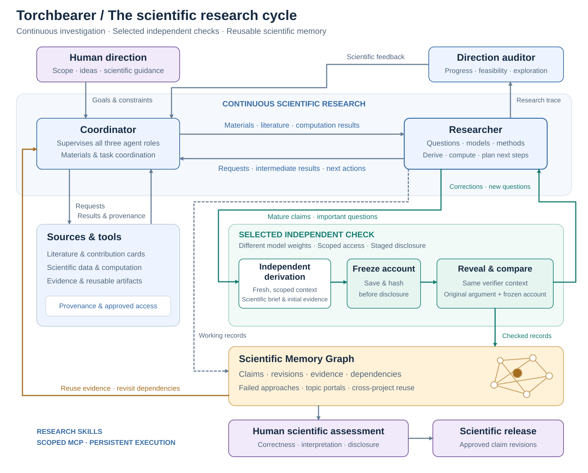
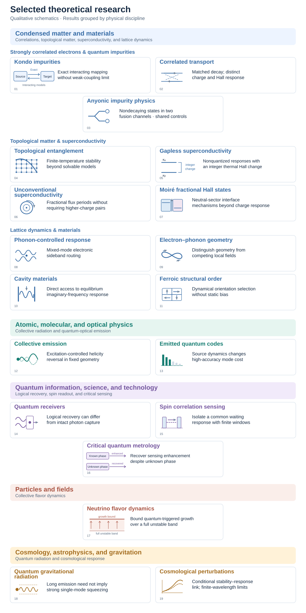

<div align="center">

# 🔥 Torchbearer

**An autonomous theoretical research system with persistent scientific memory.**

**Codex-ready Skills** &nbsp;·&nbsp; **Scoped MCP** &nbsp;·&nbsp; **Python 3.11+**

[Research cycle](#research-cycle) · [Quick start](#quick-start) · [Research highlights](#research-highlights) · [Documentation](#documentation)

</div>

One coordinator supervises three peer agent roles in Torchbearer: researchers, verifiers and direction auditors. Researchers drive theoretical investigation within human-supplied direction constraints; verifiers and auditors support their work. All coordination passes through the coordinator, while the Scientific Memory Graph connects findings with evidence.

This repository provides research Skills, a scoped MCP knowledge service and an executable Python reference runtime. Model workers and scientific tools connect through an agent backend.

## Research cycle

<p align="center">
  
</p>

**Research continues throughout the cycle.** Researchers choose questions and methods, exchanging material requests, findings and next steps with the coordinator. It supplies sources, arranges supporting work and manages access. Verification reports and direction-audit recommendations return through the coordinator to guide further research; contribution cards support attribution and novelty assessment.

**Independent verification is triggered by important questions and mature claims selected for scientific memory.** The coordinator assigns a verifier with a different model parameter identity to derive an account in a separate context using the approved scientific brief. After that account is frozen, the same verifier receives the original argument and compares the two. Discrepancies, corrections and new questions feed back into the ongoing research.

The Scientific Memory Graph connects claim revisions, assumptions, evidence, checks and failed approaches. Topic portals make earlier work available across research directions, while dependency tracking identifies conclusions to reassess when a premise changes. Human scientific assessment authorizes the release of exact claim revisions and their prerequisites.

## Quick start

Use Python 3.11 or newer. The included arithmetic demo runs locally with synthetic agents and **requires no API key**.

From the repository root:

```bash
python -m venv .venv
source .venv/bin/activate
python -m pip install .

torchbearer demo --state .torchbearer/demo.sqlite
torchbearer status --state .torchbearer/demo.sqlite
```

On Windows PowerShell, activate with `.venv\Scripts\Activate.ps1`.

The demo runs two research tasks and a two-stage verification, retaining a supported statement and a failed attempt. Running it again reuses completed work. See the [graph example](examples/graph_demo.py) for evidence tracing and revision impact.

### Codex and Claude Code

Open this repository in Codex and invoke a role such as `$torchbearer-research` or `$torchbearer-verify`. Codex discovers all five Skills in `.agents/skills/`. For Claude Code, copy the same folders into `.claude/skills/` and invoke them with slash commands.

Install the MCP integration:

```bash
python -m pip install '.[mcp]'
```

Follow [agent setup and MCP registration](mcp/README.md) to connect the scoped knowledge service. The host supplies separate agent contexts and matching access scopes.

### Connect model workers

The [command backend](docs/command-backend.md) accepts existing agent workers through JSON input/output. Python integrations can implement `AgentBackend.run`. A deployment supplies model identities, credentials, scientific data and tools; the runtime retains task state and supports restart and recovery.

## Research highlights

The results below are drawn from theoretical physics, the field for which Torchbearer’s current research workflows are primarily tailored. We envision the underlying framework as a general approach to theoretical research across scientific disciplines.

<p align="center">
  
</p>

## Scientific memory

The manuscript's 24 November 2026 snapshot contains **7,924 claim identifiers**, **473 topic views** and **12,530 claim–topic memberships**. These counts describe the organization of the research record. The graph preserves exact revisions and evidence links as findings are reused and revised.

Explore the [memory graph](docs/scientific-memory.md), [contribution cards](docs/contribution-cards.md) and [human review workflow](docs/human-review.md).

## Validation

[Isolated end-to-end validation](https://github.com/liuxian201812/Torchbearer/actions/workflows/isolated-e2e.yml) builds a wheel, installs it in a fresh environment and exercises the CLI, restart behavior, external workers and MCP stdio. These tests use synthetic protocol fixtures. The [validation report](docs/validation.md) documents the checks and reproduction steps.

## Documentation

| Topic | Guide |
| :--- | :--- |
| System and operation | [Architecture](docs/architecture.md) · [Running the framework](docs/operations.md) |
| Research feedback | [Independent verification](docs/verification.md) · [Direction review](docs/direction-audit.md) |
| Integration | [Skills and MCP](mcp/README.md) · [Command workers](docs/command-backend.md) |

## Why Torchbearer?

Civilization is sustained by a flame passed from one generation to the next: the knowledge we inherit, the questions we ask, and the understanding we leave behind.

Perhaps artificial intelligence — a new kind of intelligence built on silicon rather than carbon — can be a gift to humanity. Like a torchbearer, it can help carry the flame of knowledge, preserve what has been learned, and illuminate paths that have yet to be explored.

We chose the name **Torchbearer** to express this hope: that human and artificial intelligence may work together to keep the flame of civilization alive and carry it further.

<div align="center">

**Torchbearer** · *Carry the flame of knowledge forward.*

</div>
